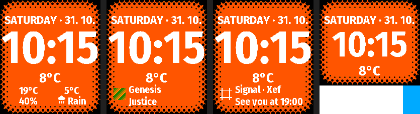

# Halftone

## Adaptive-layout beta — 1.7.0 beta 9

Halftone has one layout: a plain date, a wide clock and a primary complication
that stay in place, with a lower area that adapts to music and new
notifications. Its procedural black halftone border continues the PT2 bezel.

Install [Halftone-1.7.0-beta.9.pbw](dist/Halftone-1.7.0-beta.9.pbw).
Source: [Halftone-1.7.0-beta.9-source.zip](dist/Halftone-1.7.0-beta.9-source.zip).
This is a sideloadable testing build. Release checks and remaining device
checks are recorded in [validation](docs/VALIDATION.md).

The normal readings come from the Pebble phone app's five global
**Complications** choices. Music, optional notification summaries and low phone
battery use additional Pebble plugin subscriptions. There is no independent
weather HTTP client, pinned weather provider, temperature-unit override or
hourly forecast cache. Clock, date, watch battery and phone-connection state
remain native watch functions.

## Set up

1. Enable the Pebble app's plugin preview if your app version requires it.
2. Open **Complications** in the Pebble phone app's Settings and configure slots
   1–5. Some preview builds place this screen under **Settings → Plugins**.
3. Open Halftone's settings with its gear icon. Choose colors, text size and
   dynamic-content options, then save. There is no layout selector.
4. Allow the permissions requested by the sources you select. Music uses
   `ReadMusic`; enabling notification summaries requests notification access
   through Pebble. Connect or configure a provider in Pebble if required.

Music and status indicators default to on. Notification summaries and message
text default to off. When summaries are enabled, **Apps to show** can contain
app names separated by commas, such as `Signal, WhatsApp`; an empty field
includes all apps allowed by Pebble. Existing notifications are not replayed
when the face starts, reconnects or notification access is reconfigured.

For a weather arrangement, choose Temperature, High, Low, Precipitation and
Condition for slots 1–5. These remain five independent readings: Halftone does
not combine high/low or infer a condition from a percentage. Any supported
source reading can replace any slot.

Read the [complication layout and format guide](docs/COMPLICATIONS.md),
[dynamic-content guide](docs/DYNAMIC-CONTENT.md), or
[weather setup guide](docs/PLUGIN-WEATHER.md).

## One layout, changing lower panel



| State | Information area |
| --- | --- |
| Normal | Complication 1 centered; slots 2–5 in a two-row grid below |
| Music playing | Complication 1 remains; song title and artist replace slots 2–5, with artwork when supplied |
| New notification | Complication 1 remains; app/title and optional message text briefly replace the lower grid or music |
| Timeline Peek / Quick View | The layout compresses around Pebble's native area; only clock, date and complication 1 remain |

Notifications have priority over music and last at most 12 seconds. Paused
music yields after a five-second grace period. Secondary complications return
when neither panel is active. Missing slots keep their positions; a selected
reading without a usable value shows `--`.

Low watch battery (10% or less while not charging), low phone battery (15% or
less) and a lost phone connection use small indicators beside the primary reading, rather than
replacing the panel. These indicators can be disabled together.

Timeline continues to handle its own calendar events and other content.
Halftone does not create a second appointment panel. Timer integration is not
included in this beta. There are no custom button, touch or motion controls;
use Pebble's Music app for playback controls.

The time format, colors, extra-large text, text shadow and three-step/four-step
border remain configurable. Source icons use the chosen text color; source
images retain their own palette. Upgrading from an earlier Classic, Comic or
Stacked setting uses the same single adaptive layout.

## Readings and offline use

Halftone accepts text, numbers, booleans, timestamps and small source-supplied
icons/images. It prefers a property's short text when available. Long values
fit the available area or end in an ellipsis. Series-only readings are
unsupported and show `--`; choose a current scalar reading instead.

Global complication readings can be retained for up to two hours from their
confirmed receipt, or until the source's expiry if earlier. Reopening the face
or replaying cached data does not renew that time. Receipt time is not the
provider's observation time. Clock and date continue without the phone.

Music and notification panels are separate, short-lived context. They are not
persisted or logged, disappear on disconnection and cannot survive a native
watchface relaunch. Music and phone battery require confirmation at least every
two minutes; their subscriptions are refreshed every minute. Notification
summaries keep their original expiry even if another source updates.

Generic complications do not make a provider more accurate or refresh it more
often. Direct plugin readings can differ from values normalized for Pebble's
native Weather app; see the weather guide for that distinction.

## Languages

The weekday follows the watch's PebbleOS language. Halftone supports English,
Czech, Slovak, German, French, Spanish, Italian, Portuguese, Dutch, Polish,
Danish, Swedish, Norwegian, Finnish, Hungarian, Romanian and Turkish. Norwegian
accepts `no`, `nb` and `nn`; unsupported languages fall back to English.

Phone settings prefer the active watch language, then the phone language, and
finally English. All dynamic-content controls and status framing are translated.
Source-provided text, units and names remain as supplied.

## Build and install

Use the Pebble command-line tool and an SDK supporting the Emery target
(Pebble Time 2). From this repository:

```sh
npm ci
npm test
pebble clean
pebble build
python3 scripts/package-beta.py
```

The build includes message-key inputs in the SDK cache signature, avoiding
stale generated C/JavaScript keys across upgrades. The final step produces
`dist/Halftone-1.7.0-beta.9.pbw` with manifest version 2 and verifies the existing
UUID and unchanged SDK-built payloads. Halftone consumes plugin data; it does
not install a plugin of its own or need a plugin-only SDK project.

Install the packaged build in the Emery emulator:

```sh
pebble install --emulator emery dist/Halftone-1.7.0-beta.9.pbw
```

For a real PT2, enable Dev Connection in the Pebble phone app and use:

```sh
pebble login
pebble install --cloudpebble dist/Halftone-1.7.0-beta.9.pbw
```

See [version-specific validation and remaining device checks](docs/VALIDATION.md).

## Project structure

```text
src/c/halftone.c       Rendering, clock, native state and AppMessage
src/c/context_data.h   Ephemeral context validation and panel selection
src/pkjs/index.js      Source coordination and Clay initialization
src/pkjs/complications.js Global slot subscriptions and receipt cache
src/pkjs/context.js    Music, new notifications and low phone battery
src/pkjs/message-queue.js Shared serialized AppMessage transport
src/pkjs/complication-data.js Bounded text, artwork and five-slot packet
src/pkjs/config.js     Halftone phone-app settings
resources/fonts/      Custom date, clock and reading fonts
docs/COMPLICATIONS.md  Fixed slot map, formats and data limits
docs/DYNAMIC-CONTENT.md Context behavior, privacy and source contract
package.json          Emery target, permissions and message keys
```

## Earlier releases

Previous PBWs and source archives remain in `dist/`. The 1.6.x betas used five
fixed global complications in three layout styles. The 1.4.x–1.5.x betas used a
weather preset; the older 1.3.1 release used an independent weather client.
Their caches, settings, permissions and screenshots describe those versions,
not beta 9. Historical Store materials remain in `store/`, and earlier test
results remain under their own versions in `docs/VALIDATION.md`.

## License

Halftone's source code and original artwork are available under the
[PolyForm Noncommercial License 1.0.0](LICENSE). You may use, modify and share
them for noncommercial purposes. Commercial use requires separate permission
from Xef. Redistributed copies and derivatives must retain the license and the
required attribution notice naming Xef as the original author.

Because commercial use is restricted, Halftone is source-available rather than
OSI-approved open-source software.

### Third-party font

The bundled Fira Sans Condensed Bold font is licensed under the SIL Open Font
License 1.1. Its license text is included at
`resources/fonts/OFL-FiraSans.txt`.

`FiraSansCondensed-Bold-Time.ttf` is a derived copy used only for the oversized
numeric clock. Its fallback box glyph is empty so Pebble's bitmap-font compiler
can generate the 80–108 px clock sizes; the visible digits are unchanged.
