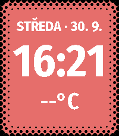

# Halftone

Open Halftone from the Pebble phone app and tap the gear icon to choose the
background and text colors. Both settings are stored on the watch and applied
immediately after saving. The dithered border remains black.

A Pebble Time 2 watchface that visually blends the screen into the physical
bezel using a procedural halftone-dot transition.

Halftone displays:

- configurable 12-hour or 24-hour time
- automatically localized day name and numeric date
- current temperature in Celsius or Fahrenheit
- a black-to-orange halftone transition drawn directly from the screen edge
- an adaptive Timeline Peek layout for upcoming events
- optional recessed-dot and floating-text optical effects



## Install the prebuilt watchface

Download [`dist/Halftone-1.3.1.pbw`](dist/Halftone-1.3.1.pbw) and open it with
the Pebble mobile app to install it. The complete Pebble Store upload kit is
available as [`dist/Halftone-1.3.1-store-release.zip`](dist/Halftone-1.3.1-store-release.zip).
You can also build the source yourself as described below.

## How it works

The watch-side C app draws the interface and updates the clock once per minute.
Every 30 minutes it asks PebbleKit JS on the connected phone for fresh weather.
The phone obtains a low-power location and first requests the temperature from
the same weather endpoint currently used by the Pebble mobile app. HTTP errors,
timeouts, malformed responses or observations over two hours old trigger a
direct Open-Meteo request with the same coordinates. No weather API key is
required. After a primary failure, requests use the fallback for an hour before
trying Pebble again.

Pebble's endpoint is an internal API, not a guaranteed public developer API;
the independent Open-Meteo fallback is essential. The current implementation
is based on the mobile app's
[getWeather method](https://github.com/coredevices/mobileapp/blob/master/pebble/src/commonMain/kotlin/coredevices/pebble/services/PebbleWebServices.kt).
The same location and units should give matching provider readings, but the
phone app and watchface still have independent update times/caches. A saved
city in the app can also differ from the phone's current GPS location.

The last successful temperature is persisted on the watch, so temporary phone
or network disconnection does not immediately blank the display. The watch also
stores the current hour plus six hours of hourly forecasts, in both units, with
UTC timestamps. After 30 minutes without a successful update it can display
the cached forecast for the current hour, prefixed with `~` (for example `~7°C`)
to distinguish an estimate from a live observation. The forecast changes as
the hours pass without needing the phone and survives restarting the watchface.
It is valid for at most six hours from when it was fetched. If neither a usable
forecast nor an observation under two hours old exists, the display becomes
`--°C` or `--°F`. Forecasts are for the last fetched location; offline travel
cannot be detected or corrected without a new phone location.

Hourly data is taken from Pebble when explicit UTC timestamps are present;
otherwise Open-Meteo supplies a supplemental forecast. A missing or malformed
forecast never discards a valid live reading, but clears the previous forecast
so another location's hours cannot be reused accidentally.

Updates are requested on startup and after reconnecting; missed
updates are retried every two minutes while connected. HTTP requests time out
after 15 seconds, and failed AppMessage deliveries get two retries. These
deadlines are enforced independently of the PKJS platform: missing location,
HTTP or AppMessage callbacks cannot leave the weather client permanently busy.
The phone also schedules its own 30-minute refresh as a backup to the watch's
requests. A request from the watch can recover a run whose timers were suspended.

Incoming AppMessages accept both named keys (as sent by the current Pebble
mobile app) and numeric keys (used by some older runners). Version 1.3.1 fixes
the numeric-only listener that ignored the mobile app's scheduled weather
requests even though startup weather worked.

The settings page can switch independently between 24-hour and 12-hour time,
and between Celsius and Fahrenheit. Both rounded units are cached, so changing
the displayed unit works immediately even while the phone is offline. A unit
change also requests the provider's native value for that unit, avoiding a
second rounding step. The fallback converts its unrounded Celsius reading to
Fahrenheit before rounding.

The weekday automatically follows the PebbleOS language. Halftone includes
English, Czech, Slovak, German, French, Spanish, Italian, Portuguese, Dutch,
Polish, Danish, Swedish, Norwegian, Finnish, Hungarian, Romanian and Turkish;
other locales fall back to English. Long translated names automatically use a
slightly smaller date font while the time remains unchanged.

When Pebble Timeline Quick View appears at the bottom of the screen, Halftone
uses the watchface unobstructed-area API to move the lower dotted edge above
the event card. The date, time and temperature are simultaneously rearranged
and switched to compact font sizes, then restored when the event card leaves.
The compact layout keeps the date below the complete top dot transition so no
row is covered by text.

## Build

Install the current Pebble command-line tool and SDK:

```sh
uv tool install pebble-tool
pebble sdk install latest
```

Then build the project:

```sh
git clone https://github.com/xefensor/halftone-watchface.git
cd halftone-watchface
pebble build
```

Run it in the Pebble Time 2 emulator:

```sh
pebble install --emulator emery
```

To install on a real Pebble Time 2, enable **Dev Connect** for the watch in the
Pebble mobile app, then run:

```sh
pebble login
pebble install --cloudpebble
```

The phone must grant location access to the Pebble app for automatic local
weather.

## Appstore release

The `store/` directory contains the final description, release notes, privacy
disclosure, raw Emery screenshots and optional 720 x 320 marketing banner.
See `store/PUBLISHING.md` for the upload checklist.

## Customize the design

The main visual parameters are near the top of `src/c/halftone.c`:

```c
#define DOT_OUTER_CORNER_RADIUS 30
#define DOT_SPACING 10
#define CLASSIC_DOT_TRANSITION_STEPS 3
#define DEPTH_DOT_TRANSITION_STEPS 4
```

The phone settings page exposes the native Pebble 64-color palette for both
the background and all text. It also has independent toggles for the original
three-step border versus a **4-step dot transition**, and for an offset black
shadow that makes the text appear to float. **Extra-large edge-to-edge text**
enlarges every information line and dynamically picks the largest time font
that fits the current digits across the PT2 display. Orange and white remain
the defaults; all optional effects default to off.

## Project structure

```text
src/c/halftone.c      Watchface rendering, time, persistence and AppMessage
src/pkjs/index.js     Phone-side weather request and Clay initialization
src/pkjs/weather.js   Pebble-first weather, Open-Meteo fallback and delivery retries
src/pkjs/forecast.js  Timestamped hourly forecast packing for offline use
src/pkjs/config.js    Pebble phone-app settings page definition
resources/fonts/      Custom date, time and temperature fonts
package.json          Pebble Time 2 target, permissions and message keys
```

## Tests

```sh
npm ci
npm test
cc -std=c99 -Wall -Wextra -Werror tests/weather-schedule.c -o /tmp/halftone-weather-test
/tmp/halftone-weather-test
cc -std=c99 -Wall -Wextra -Werror tests/weather-forecast.c -o /tmp/halftone-forecast-test
/tmp/halftone-forecast-test
```

The tests use mocked location, HTTP and AppMessage callbacks; they send no
location data to either service.

## License

Halftone's source code and original artwork are available under the
[PolyForm Noncommercial License 1.0.0](LICENSE). You may use, modify and share
them for noncommercial purposes. Commercial use requires separate permission
from Xef. Redistributed copies and derivatives must retain the license and the
required attribution notice naming Xef as the original author.

Because commercial use is restricted, Halftone is source-available rather than
OSI-approved open-source software.

### Third-party font

The bundled Fira Sans Condensed Bold font is licensed under the SIL Open Font
License 1.1. Its license text is included at
`resources/fonts/OFL-FiraSans.txt`.

`FiraSansCondensed-Bold-Time.ttf` is a derived copy used only for the oversized
numeric clock. Its fallback box glyph is empty so Pebble's bitmap-font compiler
can generate the 80–108 px clock sizes; the visible digits are unchanged.
