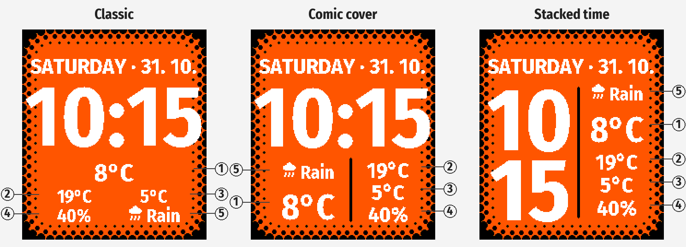

# Halftone

## Five-complication beta — 1.6.0 beta 7

Halftone displays five readings chosen in the Pebble phone app's global
**Complications** settings. Choose weather, phone battery, calendar data or
other installed plugin readings. The clock and date continue to run on the
watch, with Halftone's existing 12-hour/24-hour option.

Install [Halftone-1.6.0-beta.7.pbw](dist/Halftone-1.6.0-beta.7.pbw).
Source: [Halftone-1.6.0-beta.7-source.zip](dist/Halftone-1.6.0-beta.7-source.zip).
This is a sideloadable testing build. Automated checks and native emulator
results are recorded in [validation](docs/VALIDATION.md); physical phone/watch
testing is still needed.

All five data areas now follow global complications. This build has no weather
preset, independent weather HTTP client, pinned weather provider, temperature
unit override or hourly forecast cache. Pebble and the selected sources supply
the readings, units and any source-specific permission or sign-in flow.

## Set up

1. Enable the Pebble app's plugin preview if your app version requires it.
2. Open **Complications** in the Pebble phone app's Settings and configure slots
   1–5. Some preview builds place this screen under **Settings → Plugins**.
3. Open Halftone's settings with its gear icon. Choose **Classic**, **Comic
   cover** or **Stacked time** under **Layout style**, then save. Classic is the
   default for both new and existing installations.
4. Allow the permissions requested by the sources you selected. Connect or
   configure a provider in Pebble if that provider requires it.

For a weather arrangement, choose Temperature, High, Low, Precipitation and
Condition for slots 1–5. These remain five independent readings; Halftone does
not combine high/low or infer a condition or droplet from a percentage. Phone
battery or any other supported reading can replace any slot.



Read the [slot-by-slot layout and format guide](docs/COMPLICATIONS.md), or the
[weather setup guide](docs/PLUGIN-WEATHER.md).

## Layouts

Halftone blends the PT2 screen into the bezel with its procedural black
halftone border. The three styles place the same five numbered complications
in different fixed positions:

| Style | Arrangement |
| --- | --- |
| Classic | Slot 1 centered; slots 2–5 in two rows below |
| Comic cover | Large slot 1 at lower left, slot 5 above it, slots 2–4 down the right |
| Stacked time | Hours above minutes on the left; slots 5, 1, 2, 3, 4 down the right |

Empty slots stay empty without moving later slots. A selected reading that has
no usable value shows `--`, with a reason in Halftone's settings diagnostics.
During Timeline Peek / Quick View, every style uses the common compact clock
layout with slot 1 only; slots 2–5 return afterward.

Time and date remain live in every style. The layout, time format, colors,
extra-large text, text shadow and three-step/four-step border remain Halftone
settings. Selecting a layout does not change the global complication choices.
Source icons use the chosen text color; source images retain their own palette.

## Readings and offline use

Halftone accepts text, numbers, booleans, timestamps and small source-supplied
icons/images. It prefers a property's short text when available and can display
an icon beside the text. Long values fit the available area or end in an
ellipsis. Series-only readings are unsupported and show `--`; choose a current
scalar reading instead of an hourly or daily series.

Each reading can be retained for up to two hours from its confirmed receipt,
or until the source's expiry if earlier. Restarting, changing layout or
replaying a cached value does not renew that time. Receipt time is not the
provider's observation time. There is no six-hour forecast or separate HTTP
fallback in beta 7. The clock and date continue while the phone is unavailable.

Generic complications do not make a provider more accurate or refresh it more
often. Direct plugin readings can also differ from the values normalized for
Pebble's native Weather app; see the weather guide for that distinction.

## Languages

The weekday follows the watch's PebbleOS language. Halftone supports English,
Czech, Slovak, German, French, Spanish, Italian, Portuguese, Dutch, Polish,
Danish, Swedish, Norwegian, Finnish, Hungarian, Romanian and Turkish. Norwegian
accepts `no`, `nb` and `nn`; unsupported languages fall back to English.

Phone settings prefer the active watch language, then the phone language, and
finally English. Source-provided text, units and names are displayed as supplied
rather than translated or converted by Halftone.

## Build and install

Use the Pebble command-line tool and an SDK supporting the Emery target
(Pebble Time 2). From this repository:

```sh
npm ci
npm test
pebble clean
pebble build
python3 scripts/package-beta.py
```

The clean step regenerates SDK message keys. The final step produces
`dist/Halftone-1.6.0-beta.7.pbw` with manifest version 2 and verifies the existing
UUID and byte-identical SDK-built payloads. This watchface consumes plugin data;
it does not install a plugin of its own or need a plugin-only SDK project.

Install the packaged build in the Emery emulator:

```sh
pebble install --emulator emery dist/Halftone-1.6.0-beta.7.pbw
```

For a real PT2, enable Dev Connection in the Pebble phone app and use:

```sh
pebble login
pebble install --cloudpebble dist/Halftone-1.6.0-beta.7.pbw
```

See [version-specific validation and remaining device checks](docs/VALIDATION.md).

## Project structure

```text
src/c/halftone.c      Watchface rendering, clock, persistence and AppMessage
src/pkjs/index.js     Phone-side source subscriptions and Clay initialization
src/pkjs/complications.js Global slot selection, subscriptions and receipt cache
src/pkjs/complication-data.js Bounded text, artwork and five-slot packet
src/pkjs/config.js    Halftone phone-app settings
resources/fonts/     Custom date, clock and reading fonts
docs/COMPLICATIONS.md Fixed slot maps, supported formats and data limits
package.json         Emery target, permissions and message keys
```

## Earlier releases

Previous PBWs and source archives remain in `dist/`. The 1.4.x–1.5.x betas used
a weather preset; the older 1.3.1 release used an independent weather client.
Their caches, settings, permissions and screenshots describe those versions,
not beta 7. Historical Store materials remain in `store/`, and previous test
results remain under their own versions in `docs/VALIDATION.md`.

## License

Halftone's source code and original artwork are available under the
[PolyForm Noncommercial License 1.0.0](LICENSE). You may use, modify and share
them for noncommercial purposes. Commercial use requires separate permission
from Xef. Redistributed copies and derivatives must retain the license and the
required attribution notice naming Xef as the original author.

Because commercial use is restricted, Halftone is source-available rather than
OSI-approved open-source software.

### Third-party font

The bundled Fira Sans Condensed Bold font is licensed under the SIL Open Font
License 1.1. Its license text is included at
`resources/fonts/OFL-FiraSans.txt`.

`FiraSansCondensed-Bold-Time.ttf` is a derived copy used only for the oversized
numeric clock. Its fallback box glyph is empty so Pebble's bitmap-font compiler
can generate the 80–108 px clock sizes; the visible digits are unchanged.
