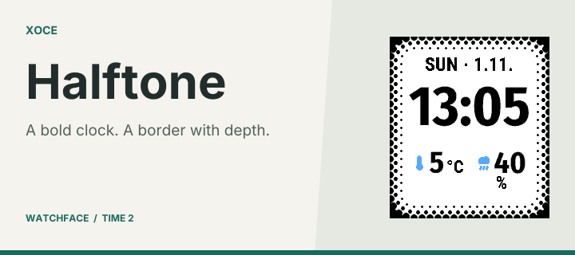
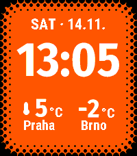
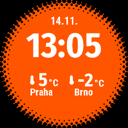

# Halftone

A watchface for **Pebble Time 2 and Round 2**, with a centred Fira clock,
a distinctive dotted border and two readings beneath the time. Choose colours,
Big text, depth and shadow while keeping room for ongoing activities.



Store artwork; [sources and provenance](store/artwork-provenance.json).

## Install Halftone 1.10.3

[View in Pebble Store](https://apps.repebble.com/48d7f4eab704414c8bc1fa7e) ·
[Product page and screenshots](https://xefensor.github.io/xoce/projects/halftone/) ·
[Set up Halftone](https://xefensor.github.io/xoce/docs/pebble/halftone/)

Halftone 1.10.3 is a published stable release for Time 2 / Emery and
Round 2 / Gabbro. Install through the official Pebble phone app. Duo and other
watch models are outside this release's targets. No separate library is needed.

For manual installation, download the matching
[Halftone-1.10.3.pbw](https://github.com/xefensor/halftone-watchface/releases/download/v1.10.3/Halftone-1.10.3.pbw)
and [SHA256SUMS.txt](https://github.com/xefensor/halftone-watchface/releases/download/v1.10.3/SHA256SUMS.txt),
then verify with `sha256sum --ignore-missing -c SHA256SUMS.txt`. The
[release page](https://github.com/xefensor/halftone-watchface/releases/tag/v1.10.3)
also contains the matching source, debugging and Store archives. The PBW's SHA-256 is
`199fdad4a20a885f66216075ed07bd336b86fe50c574413f8a5f89a3fc086a9d`.
Older releases remain available with their original source and evidence.

| Time 2 | Round 2 |
| --- | --- |
|  |  |

Native emulator examples, captured from 1.10.2 and reused for 1.10.3 after
[renderer/resource verification](store/final-gallery-reuse.json). The image bytes
and original capture versions remain unchanged; these are not physical-watch tests.

## Start with two readings

1. Pair your Time 2 or Round 2 with the [official Pebble phone app](https://repebble.com/app), then install Halftone and choose it as your active watchface.
2. Enable plugin support where your phone-app version requires it. In Pebble's **Complications** settings, choose readings for slots **1 and 2**. Halftone ignores choices 3–5.
3. Open Halftone's settings gear. **Appearance** contains colours, Text size and the separate **Big text** option, plus depth and shadow.
4. Save and wait for **✓ Saved**. That confirms phone persistence. Check the separate watch-delivery status; keep the watch connected and retry delivery when offered.

A reading can be weather, battery or another compatible source. Halftone retains
its provider's units and public qualifiers. An unconfigured position stays empty;
a selected but expired or unavailable reading shows `--`. The clock and date keep
working without a phone. [Reading behaviour](docs/COMPLICATIONS.md) ·
[Weather setup](docs/PLUGIN-WEATHER.md).

## Keep a Timer countdown in view

Install [Timer](https://xefensor.github.io/xoce/projects/timer/) separately.
In Halftone's **Content & priority**, enable **Show activity plugins**, turn on
**Show** for Timer and use its **Move up / Move down** controls to set priority.
Save, start a countdown in Timer, then press Back twice to return to Halftone.

Timer still owns its countdown and alarm; open Timer to pause or resume it.
[Open Activity](https://xefensor.github.io/xoce/projects/open-activity/) can add
optional Quick Launch shortcuts: choose Halftone as that helper's source and
match its configured shortcuts in Pebble. It opens the associated app, not a
particular timer. [Illustrated setup](https://xefensor.github.io/xoce/docs/pebble/setup/#illustrated-first-setup).

Shared readings and activities need plugin support, relevant source permissions
and a connected phone. Built-in music and notification sources require Android.
Notifications and message text start off; enable private content deliberately.
Halftone displays activity data and app destinations, without playback or Timer
controls. [Activities, privacy and interactions](docs/DYNAMIC-CONTENT.md).

## Display preferences

Text size can follow the watch or use Small, Medium or Large. **Big text** remains
a separate clock/date/reading option. Day and Night palettes stay independent;
appearance can select a palette or follow Quiet Time. Automatic Follow Pebble
appearance is unavailable on SDK 4.44 and retains its last explicit Light/Dark
fallback. Phone-page appearance is independent of the watch palette.

[Current UI](docs/UI.md) · [Troubleshooting and support](SUPPORT.md) ·
[Privacy](PRIVACY.md). Versioned source tests, browser simulations, native emulator
renders and physical-device checks remain different evidence.

## Develop and contribute

[CONTRIBUTING](CONTRIBUTING.md) selects Node 22.23.4, Python 3.12.15, Pillow 13.0.0
and a C99 compiler for portable checks. Native builds additionally require the
pinned Pebble SDK 4.44 tooling. Ordinary builds use committed font geometry.

```sh
python3 -m pip install -r requirements-test.txt
npm ci --ignore-scripts
npm test
# With the pinned Pebble SDK selected:
npm run build
npm run check:artifact
npm run check:config
```

Use a Python virtual environment as described in CONTRIBUTING. Outputs belong in
ignored `build/`; `dist/`, released archives, tags and historical QA remain frozen.
The app bundles Core 0.6.0, Activities 0.4.5 and UI 0.1.3 snapshots under `vendor/`.
Those app dependencies are separate from the public standalone library releases.
[Dependency ownership](docs/SHARED-CORE.md) · [Release maintenance](docs/GITHUB-RELEASES.md).

## Licence and history

[PolyForm Noncommercial 1.0.0](LICENSE) covers Halftone's source and original
artwork. Preserve its required notices and attribution. This is source-available
software; commercial use requires separate permission. Fira Sans Condensed and
Roboto Condensed retain their OFL notices in [third-party notices](THIRD-PARTY-NOTICES.md)
and [font provenance](resources/fonts/font-provenance.json).

The [documentation history](docs/history/publication-docs-2026-11-15.md) links the
earlier preparation guides. Published source archives and prior beta/RC records
retain their original scope and bytes.
