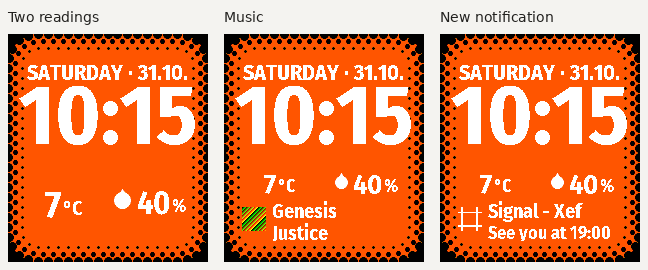

# Two complications in the adaptive layout

**Halftone 1.9.0 rc.1** uses the first two global complication choices in the
Pebble phone app. A complication is a source reading: a temperature, phone
battery level, calendar time, condition or another plugin property. Clock and
date remain native watch functions and do not consume a slot.

## Choose the two readings

Open **Complications** in the Pebble phone app's Settings; some preview versions
place it under **Settings → Plugins**. Configure slots **1 and 2**. Choices 3–5
are ignored by Halftone: it does not subscribe to their sources, display them or
retain their data in its phone cache. Those choices remain available to other
watchfaces.

Temperature in slot 1 and Precipitation in slot 2 make a compact weather setup.
Alternatively, use phone battery, humidity or any other supported reading.
There is no fixed weather preset, local unit conversion or automatic high/low
aggregation. Saved time format, colors and effects survive relaunching.

## Where the readings appear

| Global complication | Normal presentation | During music or a new notification |
| --- | --- | --- |
| 1 | Large, centered reading in the left column | Smaller reading in the left half of a compact row above the panel |
| 2 | Large, centered reading in the right column | Smaller reading in the right half of the same compact row |
| 3–5 | Not used by Halftone | Not used by Halftone |

The two columns share a baseline and equal widths. A missing slot keeps its
left/right position; an empty first slot does not move the second into its
place. A selected reading waiting for data, denied permission or an unsupported
format shows `--`.

The date stays plain and the wide clock stays anchored while the lower content
changes. During **Timeline Peek / Quick View**, the clock and date compress
around Pebble's native area with **complication 1 only**. Complication 2, music
and notification summaries stay hidden until Peek closes. Halftone does not
read or duplicate Timeline's own events. Small battery/connection indicators
sit beside the reading row when enabled.

Both complications remain visible during music and notification panels. They
return to their larger size when the panel clears. Timeline Peek is the native
exception: only complication 1 remains while Pebble owns the lower screen.

## Numbers, units and artwork

A property can supply several formats. Halftone prefers usable `shortText`,
then supports a numeric value, longer text, a boolean or a timestamp. Source
formatting and units are preserved; a real zero is valid.

Recognized number/unit strings use large digits with a smaller unit, such as
`7` with `°C`. Locale decimal punctuation and signs remain as supplied. Dates,
times, numeric ranges and unrecognized text are drawn as a whole readable
string rather than guessed into a numeric format. Long text fits the area or
ends in an ellipsis.

A droplet is reserved for **weather/location → precipitation** with a valid
0–100% probability. The coordinator supplies an explicit presentation hint;
the renderer also checks the percentage syntax. Battery, humidity and arbitrary
percentages remain generic readings. A condition is never inferred from a
percentage or another slot.

| Source format | Display |
| --- | --- |
| `shortText` | Source's compact text; preferred when available |
| `numericValue` | Number and its supplied unit |
| `longText` | Text fitted or ellipsized to the reading area |
| `boolean` | Localized state text |
| `timestamp` | Watch-local time respecting the 12-hour/24-hour choice |
| `icon` / `image` | Small source artwork, with text when both are supplied |
| Series only | `--` and an unsupported-format diagnostic |

Source icons use the chosen text color; images retain their palette. Text
packets retain at most 48 UTF-8 bytes without cutting a scalar. Missing data
never becomes a fake zero. Series are not automatically sampled at their first
value; select a current scalar reading instead.

Music/notification artwork and the short halftone panel transition are described
in [dynamic content](DYNAMIC-CONTENT.md).

## Sources, access and cache

Pebble chooses the provider for each category/item. Units and provider sign-in
belong to Pebble or the provider. Halftone declares `ReadMusic` and no Internet
or hard-coded Location permission. Pebble requests access needed by selected
sources through its normal flow; notification summaries are opt-in.

The two readings can be cached for at most **two hours from their original
confirmed receipt**, capped by an earlier source expiry. Reopening or replaying
data cannot renew confirmation. Receipt time is not the measurement or model
issue time. After expiry, a selected reading shows `--` until data arrives.
There is no independent HTTP fallback; clock and date continue on the watch.

The phone cache uses a two-reading signature and does not restore an older
five-reading cache. Native version-1 snapshots can still be decoded during an
upgrade, but only the first two positions can be displayed. Contextual music
and notifications have separate short leases and are never persisted as
context. Choosing such a property as one of the two global readings follows
the generic reading-cache rules instead.

A direct source may differ from Pebble's normalized native Weather display.
See [weather setup and comparison](PLUGIN-WEATHER.md).

## Source and packet contract

Halftone reads `preferences/complications`, then subscribes to sources selected
by preference IDs `"0"` and `"1"` only. Empty choices are omitted from the
preference envelope, so array position is not the slot number. The separate
`index.numericValue.value` selects an underlying source instance by zero-based
position, not by stable instance ID. Reordering instances can retarget a choice.

The transport still has five records because contextual snapshots share its
codec. The global-reading encoder emits EMPTY records at indices 2–4. Version 2
keeps the 20-byte record header and uses byte 5 as `displayKind`: 0 is generic,
1 is precipitation probability. The native decoder accepts version 1 and
version 2; version 1 requires that byte to remain zero. Unknown hints and invalid
record combinations fail complete-snapshot validation. Context records require
kind 0 and do not accept weather presentation hints.

`validUntilMs` is milliseconds. `timestamp.value` is epoch seconds representing
the displayed moment, not freshness. Unsupported or malformed readings are
diagnosed rather than replaced with a different source.

References: [plugin guide](https://developer.repebble.com/guides/plugins/preview/),
[preference serialization](https://github.com/coredevices/mobileapp/blob/master/pebble/src/commonMain/kotlin/coredevices/pebble/plugin/PreferencesPlugin.kt),
and [shape definitions](https://github.com/coredevices/mobileapp/blob/master/libpebble3/src/commonMain/kotlin/io/rebble/libpebblecommon/plugin/Plugin.kt).
