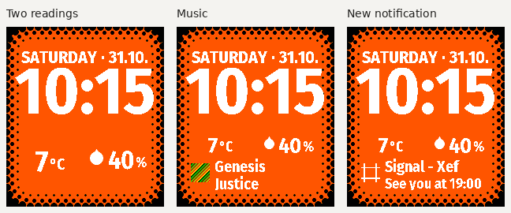

# Earlier Halftone README

Historical source and release description retained on 8 November 2026. Use the
[current README](../../README.md) and [contributor guide](../../CONTRIBUTING.md) for the active workflow.

# Halftone

## Development candidate

Halftone now adopts Core 0.5.2, Activities 0.4.4 and shared UI 0.1.1, with plugin
activities, editable primary/secondary priorities, presented-activity navigation,
current privacy/cache handling and reliable phone settings delivery. Its centered Fira
clock, dot border, Big text, depth and shadow remain Halftone's own.

The local development SDK label remains 1.9.0. This work does **not** replace the
published rc.6 PBW or its validation evidence. Use [CONTRIBUTING](../../CONTRIBUTING.md)
for candidate builds and [current UI](../../docs/UI.md) / [maintenance contracts](../../docs/MAINTENANCE.md)
for the new behavior. See [candidate validation](../../docs/DEVELOPMENT-VALIDATION.md) for
checks and remaining device/browser gaps. The release-specific material below describes rc.6.

## Shared-core release candidate — 1.9.0 rc.6

Halftone pairs a plain date and wide clock with two large readings side by
side. When music or a new notification appears, both readings become smaller
and stay visible above the contextual panel. Its procedural black halftone
border continues the PT2 bezel. Both readings also stay visible when Pebble
opens Timeline Peek.

The current GitHub release is
[**v1.9.0-rc.6**](https://github.com/xefensor/halftone-watchface/releases/tag/v1.9.0-rc.6),
marked as a prerelease for Pebble Time 2 / Emery:

- [Installable PBW](https://github.com/xefensor/halftone-watchface/releases/download/v1.9.0-rc.6/Halftone-1.9.0-rc.6.pbw)
- [Source archive](https://github.com/xefensor/halftone-watchface/releases/download/v1.9.0-rc.6/Halftone-1.9.0-rc.6-source.zip)
- [Prepared store package](https://github.com/xefensor/halftone-watchface/releases/download/v1.9.0-rc.6/Halftone-1.9.0-rc.6-store-package.zip)
- [SHA-256 checksums](https://github.com/xefensor/halftone-watchface/releases/download/v1.9.0-rc.6/SHA256SUMS.txt)

The PBW's numeric SDK version is **1.9.0**; `rc.6` identifies the candidate
in its filename and GitHub tag. The PBW and ZIP archives also remain in `dist/`;
the attached checksum file lists only this release's three assets.
This candidate is for sideloading with Pebble's plugin preview enabled. Pebble's
[current plugin guide](https://developer.repebble.com/guides/plugins/) says not
to publish apps using plugins to the public appstore yet. Public submission
awaits the end of that restriction and phone/watch confirmation. Release checks
are recorded in [validation](../../docs/VALIDATION.md); see the
[publishing checklist](../../store/PUBLISHING.md) before submitting.

The normal readings use the **first two** global **Complications** choices in
the Pebble phone app. Choices 3–5 are ignored by the new source subscriptions
and phone cache. Music, optional notification summaries and low phone
battery use additional Pebble plugin subscriptions. There is no independent
weather HTTP client, pinned weather provider, temperature-unit override or
hourly forecast cache. Clock, date, watch battery and phone-connection state
remain native watch functions.

## Shared engine

Halftone uses [Pebble Watchface Core](https://github.com/xefensor/pebble-watchface-core)
0.1.0 for complication subscriptions, phone communication and native
freshness/cache/context state. The exact release archive is pinned in `vendor/`
and recorded in `package-lock.json` and `vendor/CORE.json`. Halftone still owns
its dot border, layout, fonts, settings presentation and app identity. Users
install the PBW as usual; there is no separate core app to install.

See [the migration and dependency-update notes](../../docs/SHARED-CORE.md).

## Set up

[Settings preview: light](../../docs/images/settings-light.png) · [dark](../../docs/images/settings-dark.png)

1. Enable the Pebble app's plugin preview if your app version requires it.
2. Open **Complications** in the Pebble phone app's Settings and configure slots
   1–2. Some preview builds place this screen under **Settings → Plugins**.
3. Open Halftone's settings with its gear icon. Appearance comes first, followed
   by complications, dynamic content and effects; status and help are at the
   bottom. Choose your options, then save. There is one layout.
4. Allow the permissions requested by the sources you select. Music uses
   `ReadMusic`; enabling notification summaries requests notification access
   through Pebble. Connect or configure a provider in Pebble if required.

Music and status indicators default to on. Notification summaries and message
text default to off. When summaries are enabled, **Apps to show** accepts
app names separated by commas, such as `Signal, WhatsApp`; an empty field
includes all apps allowed by Pebble. Existing notifications are not replayed
when the face starts, reconnects or notification access is reconfigured.

For a weather arrangement, choose Temperature in slot 1 and Precipitation in
slot 2. Any supported source reading can replace either choice. A droplet is
used only for the weather source's valid precipitation-probability reading; a
battery or humidity percentage does not become a rain indicator.

Read the [complication layout and format guide](../../docs/COMPLICATIONS.md),
[dynamic-content guide](../../docs/DYNAMIC-CONTENT.md), or
[weather setup guide](../../docs/PLUGIN-WEATHER.md).

## Two readings, with room for context



| State | Information area |
| --- | --- |
| Normal | Two equally sized columns: complication 1 on the left and complication 2 on the right |
| Music playing | Both readings shrink into a horizontal row above two left-aligned title/artist lines |
| New notification | Both compact readings remain above the app/title and optional message text; the notification briefly takes priority over music |
| Timeline Peek / Quick View | Clock and date compress above two compact horizontal readings; Pebble owns the lower native panel |

Notifications have priority over music and last at most 12 seconds. Paused
music yields after a five-second grace period. Both readings return to their
large presentation when neither panel is active. Timeline Peek temporarily
hides Halftone's own contextual panel while keeping both selected readings
above Pebble's panel. Missing slots keep their
left/right positions; a selected reading without a usable value shows `--`.

Low watch battery (10% or less while not charging), low phone battery (15% or
less) and a lost phone connection use compact indicators beside the readings.
They do not take over the panel and can be disabled together.

Timeline continues to handle its own calendar events and other content.
Halftone does not create a second appointment panel. Timer integration is not
included in this candidate. There are no custom button, touch or motion controls;
use Pebble's Music app for playback controls.

Numbers with recognized units use larger digits and smaller units, preserving
the source's formatted value. Unknown text, ranges and times keep their readable
whole-text presentation. Artwork is omitted when removing it lets the full
context title fit; otherwise long content ends in a clean ellipsis.

**Brief halftone transitions** is on by default. Real incoming panel-content
changes can dissolve over 180 ms. The clock fits to the available space when
the context mode changes, then stays still with the date and bezel during
the dissolve frames.
Both complications adjust together to make room for the panel. Identical
updates do not animate. Privacy clears, expiry, disconnection and Timeline
Peek do not delay hiding content for an animation.

Clock placement uses the visible bounds of the compiled digit fonts instead
of the font line box. Times such as `22:14` sit lower and more evenly between
the date and readings, while taller narrow times such as `1:05` retain their
clearance. The clock fits to the available space above active context as well
as to its width. Accented weekday letters retain extra clearance above the clock.

Music artwork and notification icons share a compact box beside the text:
32 pixels normally or 40 with Big text for a two-line panel, and 28 pixels
for a single line. Their visible bottom edge aligns with the visible bottom
of the fitted music or notification text, excluding its shadow. Transparent
icon padding and any empty space from fitting an image are accounted for.
Incoming source artwork remains capped at 24 pixels; scaling adds no image
detail. Rectangular music images are center-cropped to a square without
stretching. Generic complication images and notification icons fit inside
their boxes without cropping. Music artwork remains optional and can be
hidden to let a full title fit. This candidate retains the artwork/icon
placement, box sizes, clock and text positions introduced in rc.5.

Date margins and clock fitting keep text clear of the border. The compact
date uses the full localized weekday and day/month, such as `SATURDAY · 31.10.`.
**Big text** enlarges the weekday/date, clock, both readings and their units,
and music or notification text. At full height, short readings can use a
44-pixel font instead of the standard 38-pixel font. Text fits down when a long
value or title needs more room; Timeline Peek keeps both compact readings
visible. The setting retains its existing saved preference when upgrading.

The time format, colors, text shadow and three-step/four-step border remain
configurable. The dot pattern and rounded border geometry are unchanged. Source icons use the chosen text color; source
images retain their own palette. Upgrading from an earlier Classic, Comic or
Stacked setting uses the same single adaptive layout.

## Readings and offline use

Halftone accepts text, numbers, booleans, timestamps and small source-supplied
icons/images. It prefers a property's short text when available. Long values
fit the available area or end in an ellipsis. Series-only readings are
unsupported and show `--`; choose a current scalar reading instead.

The two selected complication readings can be retained for up to two hours
from their confirmed receipt, or until the source's expiry if earlier. Reopening the face
or replaying cached data does not renew that time. Receipt time is not the
provider's observation time. Clock and date continue without the phone.

Music and notification panels are separate, short-lived context. They are not
persisted or logged, disappear on disconnection and cannot survive a native
watchface relaunch. Music and phone battery require confirmation at least every
two minutes; their subscriptions are refreshed every minute. Notification
summaries keep their original expiry even if another source updates.

Generic complications do not make a provider more accurate or refresh it more
often. Direct plugin readings can differ from values normalized for Pebble's
native Weather app; see the weather guide for that distinction.

## Languages

The weekday follows the watch's PebbleOS language. Halftone supports English,
Czech, Slovak, German, French, Spanish, Italian, Portuguese, Dutch, Polish,
Danish, Swedish, Norwegian, Finnish, Hungarian, Romanian and Turkish. Norwegian
accepts `no`, `nb` and `nn`; unsupported languages fall back to English.

Phone settings prefer the active watch language, then the phone language, and
finally English. All dynamic-content controls and status framing are translated.
Source-provided text, units and names remain as supplied.

## Build and install

Use the Pebble command-line tool and an SDK supporting the Emery target
(Pebble Time 2). From this repository:

```sh
npm ci --ignore-scripts
npm test
pebble clean
pebble build
python3 scripts/package-beta.py
python3 scripts/check-clock-fonts.py --pbw dist/Halftone-1.9.0-rc.6.pbw
```

The build includes message-key inputs and complete font definitions in SDK cache
signatures, avoiding stale C/JavaScript keys or missing newly requested glyphs.
Packaging produces `dist/Halftone-1.9.0-rc.6.pbw` with manifest version 2 and verifies the existing
UUID and unchanged SDK-built payloads. Halftone consumes plugin data; it does
not install a plugin of its own or need a plugin-only SDK project.

If changing fonts, run the verifier command with `--write-context-metrics` to
regenerate `src/c/context_text_metrics.h`, then rebuild and package again before
the final check.

Install the packaged build in the Emery emulator:

```sh
pebble install --emulator emery dist/Halftone-1.9.0-rc.6.pbw
```

For a real PT2, enable Dev Connection in the Pebble phone app and use:

```sh
pebble login
pebble install --cloudpebble dist/Halftone-1.9.0-rc.6.pbw
```

See [version-specific validation and remaining device checks](../../docs/VALIDATION.md).

Versioned GitHub downloads publish automatically from the checked packages on
`main`; GitHub Actions does not build the SDK project or submit an appstore
release. See [GitHub release preparation](../../docs/GITHUB-RELEASES.md) for archive,
checksum and publication checks. Published downloads stay unchanged when only
the documentation is updated.

Contributor guidance and compatibility rules are in [AGENTS.md](../../AGENTS.md).

## Project structure

```text
src/c/halftone.c       Rendering, clock and SDK event routing
src/c/context_data.h   Compatibility include for the shared context helpers
src/pkjs/index.js      Source coordination and Clay initialization
src/pkjs/complications.js Shared-core adapter preserving the legacy cache key
src/pkjs/context.js    Shared-core context adapter
src/pkjs/message-queue.js Shared-core transport adapter
src/pkjs/complication-data.js Shared-core wire adapter
vendor/               Pinned core archive and provenance
src/pkjs/config.js     Halftone phone-app settings
src/pkjs/settings-page.js Compact light/dark settings presentation
resources/fonts/      Custom date, clock and reading fonts
docs/COMPLICATIONS.md  Fixed slot map, formats and data limits
docs/DYNAMIC-CONTENT.md Context behavior, privacy and source contract
docs/SHARED-CORE.md    Engine extraction and dependency updates
docs/GITHUB-RELEASES.md Automated GitHub downloads and release preparation
AGENTS.md             Contributor invariants and verification commands
package.json          Emery target, permissions and message keys
```

## Earlier releases

Previous PBWs and source archives remain in `dist/`. Candidate 1 used two
horizontal readings but kept only the primary reading during Timeline Peek;
its large-clock option did not enlarge complication text. See [the
changelog](../../CHANGELOG.md) for candidate changes. Beta 10 used two stacked
full-width readings and temporarily replaced the second with context. Beta 9
used five global complications in one adaptive layout. The 1.6.x betas used five fixed global
complications in three layout styles. The 1.4.x–1.5.x betas used a
weather preset; the older 1.3.1 release used an independent weather client.
Their caches, settings, permissions and screenshots describe those versions,
not this candidate. Current store materials are in `store/`; earlier test
results remain under their own versions in `docs/VALIDATION.md`.

## License

Halftone's source code and original artwork are available under the
[PolyForm Noncommercial License 1.0.0](../../LICENSE). You may use, modify and share
them for noncommercial purposes. Commercial use requires separate permission
from Xef. Redistributed copies and derivatives must retain the license and the
required attribution notice naming Xef as the original author.

Because commercial use is restricted, Halftone is source-available rather than
OSI-approved open-source software.

### Third-party font

The bundled Fira Sans Condensed Bold font is licensed under the SIL Open Font
License 1.1. Its license text is included at
`resources/fonts/OFL-FiraSans.txt`.

`FiraSansCondensed-Bold-Time.ttf` is a derived copy used only for the oversized
numeric clock. Its fallback box glyph is empty so Pebble's bitmap-font compiler
can generate the 80–108 px clock sizes; the visible digits are unchanged.
